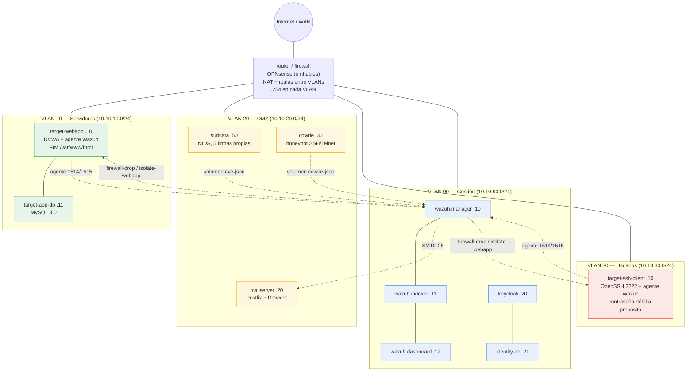
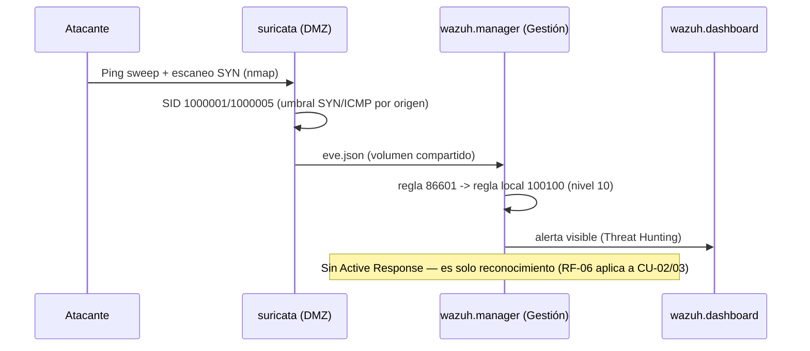
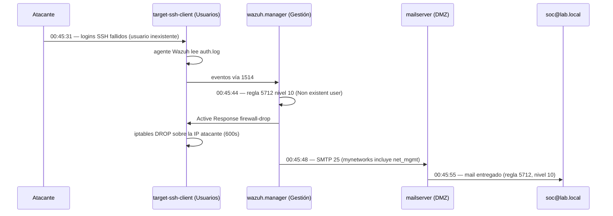
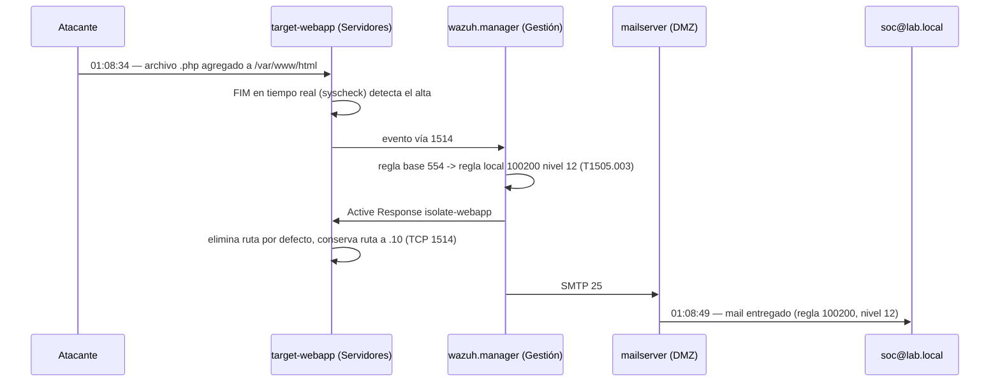

# Arquitectura — Tarea 3 (Blue Team)

> **Estado: BORRADOR** — depende de `40-consigna-propia.md`. Usa la plantilla 4+1 del
> curso para la vista física, que es la **obligatoria y central** en esta tarea
> (LETRA.md §0.2), y C4 niveles 1-2 para el resto (LETRA.md tabla "Uso por tarea": T3 no
> requiere C4 nivel 3/4, salvo que se agregue código de seguridad propio).
>
> La arquitectura es la misma en los dos entornos soportados: **VirtualBox** (`vagrant/`,
> desde cero en cualquier máquina) o **Proxmox** (`infra/README.md` → "Alternativa").
> Solo cambia cómo el hipervisor implementa cada VLAN (columna "Red del hipervisor").
> Antes de la auditoría, confirmar que esta vista coincide con el entorno que se va a
> mostrar (lo exige la plantilla 4+1).

| Campo | Valor |
|---|---|
| Código | ARQ-T3-01 |
| Versión | 0.5 (borrador — falta aprobación docente) |
| Equipo | Blue Team — fmq203, Renzo Rampoldi |
| Fecha | 14/10/2026 |
| Aprobación | Docente — **pendiente** |

---

## 1. Vista Física (4+1) — obligatoria y central

### 1.1 Segmentos de red

| VLAN | Rol | Subred | Gateway (router) | Red del hipervisor (VirtualBox / Proxmox) |
|---|---|---|---|---|
| — | Internet / WAN | `203.0.113.0/24` en VirtualBox (simulada); red con salida real en Proxmox | `.254` | `vlan_wan` / bridge con salida a internet |
| 10 | Servidores | 10.10.10.0/24 | 10.10.10.254 | `vlan_srv` / bridge aislada |
| 20 | DMZ | 10.10.20.0/24 | 10.10.20.254 | `vlan_dmz` / bridge aislada |
| 30 | Usuarios | 10.10.30.0/24 | 10.10.30.254 | `vlan_usr` / bridge aislada |
| 90 | Gestión | 10.10.90.0/24 | 10.10.90.254 | `vlan_mgmt` / bridge aislada |

Cada VLAN es una red virtual aislada del hipervisor (no hay trunking 802.1Q dentro de
las VMs): el router y `docker-host` tienen una NIC dedicada por VLAN.

### 1.2 Nodos

| Nodo | Rol | Componentes | IP | Recursos | Estado |
|---|---|---|---|---|---|
| `router` (VM) | Firewall/router, NAT | OPNsense (o Linux + nftables en VirtualBox) | .254 en cada VLAN | 1-2 cores / 1-2 GB | ✅ |
| `docker-host` (VM en VirtualBox, LXC privilegiado en Proxmox) | Host de contenedores, 1 NIC por VLAN | Docker Engine + todos los stacks de abajo | .5 en cada VLAN | 2 cores / 9-10 GB | ✅ |
| `identity` (Docker, VLAN Gestión) | MFA administrativo | Keycloak 26.0 + Postgres 16 | 10.10.90.20 (DB .21) | ~1 GB | ✅ contenedor; MFA sin configurar |
| `siem-hids: manager` (Docker, VLAN Gestión) | SIEM, correlación, API | Wazuh manager 4.9.0 | 10.10.90.10 | — | ✅ |
| `siem-hids: indexer` (Docker, VLAN Gestión) | Almacenamiento/búsqueda | Wazuh indexer 4.9.0 (OpenSearch) | 10.10.90.11 | ~1 GB heap | ✅ |
| `siem-hids: dashboard` (Docker, VLAN Gestión) | Consola web | Wazuh dashboard 4.9.0 | 10.10.90.12 | — | ✅ puerto 5601 |
| `nids` (Docker, **VLAN DMZ**) | IDS de red | Suricata 8.0 | 10.10.20.50 | ~0.5 GB | ✅ (ver nota de mirroring) |
| `mail` (Docker, VLAN DMZ) | Correo corporativo | docker-mailserver | 10.10.20.20 | ~0.5 GB | ✅ |
| `honeypot` (Docker, VLAN DMZ) | Trampa de reconocimiento | Cowrie | 10.10.20.30 | ~0.25 GB | ✅ |
| `wazo` (Docker, VLAN DMZ) | Telefonía/atención al cliente | Wazo PBX | 10.10.20.40 (reservada) | ~1.5-2 GB | ❌ no construido |
| `alerting` (Docker, VLAN Gestión) | 2º canal de alertas | Relay webhook | 10.10.90.40 (reservada) | ~0.1 GB | ❌ no construido |
| `targets: webapp + db` (Docker, VLAN Servidores) | App de préstamos | DVWA + MySQL 8.0, imagen propia `web-victim/` con agente Wazuh embebido + FIM en tiempo real sobre `/var/www/html` | 10.10.10.10 (DB .11) | ~1 GB | ✅ agente verificado (CU-03, 14/10) |
| `targets: ssh-client` (Docker, VLAN Usuarios) | Host SSH víctima | Imagen propia `ssh-victim/`: OpenSSH 2222 + agente Wazuh embebido, contraseña débil a propósito | 10.10.30.10 | — | ✅ agente verificado (CU-02, 14/10) |
| `soar-thehive-optional` | SOAR ampliado | TheHive + Cortex + Cassandra + ES | — | ~3-4 GB | ❌ no construido, no hace falta (RF-06 con Wazuh Active Response) |

✅ = construido y probado. Todos los contenedores llevan IP fija.

> **Por qué Suricata está en la DMZ y no en Gestión:** un contenedor Docker ve cada red
> a la que está conectado como `eth0`, `eth1`... en orden de conexión; con una sola red,
> su interfaz de captura es siempre `eth0`. Hoy ve el tráfico de la DMZ, no un espejo
> explícito del router — pendiente de decisión, ver `infra/README.md` → "Qué falta".

### 1.3 Diagrama de red (topología real, 14/10/2026)

Todos los contenedores corren en `docker-host` (una NIC por VLAN, redes Docker
**macvlan**). Las líneas punteadas son los flujos lógicos de la cadena de detección
(agentes/sensores → manager), respuesta (manager → Active Response en el agente) y
notificación (manager → mail). `docker-host` no puede hablar con sus propios
contenedores (limitación de macvlan) — se accede desde el router o desde otra VM.

`wazo` (telefonía) y `alerting` (2º canal) no se construyeron — recorte justificado,
ver `brain/decisions.md` 2026-10-05.

> Nota: el host SSH víctima (RT-02/CU-02) vive en VLAN Usuarios, no en VLAN Servidores
> — simula un puesto comprometido, no el servidor de la app. Ver `infra/targets/docker-compose.yml`.

### 1.4 Copias de seguridad y puntos de monitoreo

- Captura de tráfico: `nids` (Suricata) en la VLAN DMZ, verificado (CU-01). Espejo del
  router hacia el NIDS más allá de su propia IP: pendiente de decisión.
- Agente Wazuh en el host SSH víctima y en la app (puertos 1514/1515): **verificado**
  (CU-02 y CU-03, 14/10 — ver `brain/LEARNINGS.md`).
- Logs de Suricata → Wazuh: verificado (CU-01). Logs de Cowrie → Wazuh: configurado,
  sin verificar en el dashboard.
- Backup de configuración de `siem-hids` e `identity` → pendiente de definir mecanismo
  (RF-13/RNF-08; `docs/06-plan-continuidad.md` §2).

### 1.5 Cadena detección → respuesta → notificación (verificada de punta a punta)

Los tres casos de uso construidos están verificados con evidencia real
(`docs/evidencias/`), con los tiempos medidos el 14/10/2026.

**CU-01 — Reconocimiento (sin contención automática por diseño):**

**CU-02 — Fuerza bruta SSH → bloqueo → mail** (MTTD ≈13s, MTTR ≈0s, +24s notificación):

**CU-03 — Webshell → aislamiento → mail** (MTTD/MTTR ≈0s, +15s notificación):

Detalle completo, con los JSON de alerta y los comandos de verificación, en
`docs/evidencias/CU-01_INC-2026-001/`, `docs/evidencias/CU-02/` y
`docs/evidencias/CU-03_INC-2026-003/`.

## 2. C4 — Nivel 1: Contexto

| Actor/Sistema externo | Relación con el sistema | Datos intercambiados |
|---|---|---|
| Cliente de FinSegura (internet) | Usa la app de préstamos | Credenciales, datos financieros (TLS) |
| Administrador/IT | Gestiona consolas vía MFA | Credenciales + TOTP/WebAuthn |
| Atacante (Red Team) | Intenta comprometer DMZ/servidores | Tráfico de reconocimiento/explotación |
| Operador de cobranza | Usa Wazo para llamadas | Audio SIP/RTP, datos de contacto |
| Canal de alerta externo (Telegram/Discord, SMTP) | Recibe notificaciones del SIEM/SOAR | Alertas de seguridad |

## 3. C4 — Nivel 2: Contenedores

| Contenedor | Tecnología | Responsabilidad | Despliegue | Protocolo |
|---|---|---|---|---|
| App de préstamos + DB | DVWA + MySQL 8.0 (placeholder vulnerable, se mantiene por el atraso) | Servicio de negocio expuesto a clientes | Docker, VLAN Servidores | HTTP / SQL |
| Host SSH cliente víctima | `linuxserver/openssh-server`, password débil intencional | Simula puesto de usuario comprometible (RT-02/CU-02) | Docker, VLAN Usuarios | SSH |
| Wazuh manager+indexer+dashboard | Wazuh | SIEM + HIDS/FIM, correlación | Docker, VLAN Gestión | Syslog/Beats, HTTPS |
| Suricata | Suricata 8.0 | NIDS, firmas sobre tráfico de su red | Docker, VLAN DMZ | — |
| Keycloak | Keycloak | MFA administrativo (TOTP/WebAuthn) | Docker, VLAN Gestión | HTTPS/OIDC |
| Cowrie | Cowrie | Honeypot SSH/Telnet | Docker, VLAN DMZ | SSH/Telnet (falsos) |
| docker-mailserver | Postfix+Dovecot | Correo corporativo, canal de alerta 1 | Docker, VLAN DMZ | SMTP/IMAP |
| Wazo PBX | Wazo/Asterisk | Telefonía, canal de verificación humana | Docker, VLAN DMZ | SIP/RTP |
| Alerting relay | Relay de webhook (no construido) | Canal de alerta 2 (Telegram/Discord) | Docker, VLAN Gestión | HTTPS webhook |

## 4. Escenarios (el "+1" de 4+1)

Los 5 casos de uso de `40-consigna-propia.md` §3, mapeados a vistas:

| ID escenario | Descripción | Vistas que toca | Cómo se valida |
|---|---|---|---|
| ESC-01 (CU-01) | Reconocimiento/escaneo DMZ | Física, Procesos | ✅ Alerta Suricata visible en Wazuh (05/10) |
| ESC-02 (CU-02) | Fuerza bruta SSH | Física, Procesos | ✅ Playbook bloquea IP + mail (14/10) |
| ESC-03 (CU-03) | Webshell en la app | Física, Lógica, Procesos | ✅ FIM detecta archivo; host aislado + mail (14/10) |
| ESC-04 (CU-04) | Credenciales robadas | Lógica (Keycloak), Procesos | ❌ Pendiente — TOTP validado en Keycloak, pero sin playbook ni integración con el SIEM |
| ESC-05 (CU-05) | Exfiltración por DNS | Física, Procesos | ❌ Pendiente |

## 5. Pendiente

- [x] ~~Router + 4 VLANs + docker-host~~ (automatizado en `vagrant/`).
- [x] ~~Stacks identity, mail, honeypot, targets, nids, siem-hids~~ — construidos y probados.
- [x] ~~Instalar agente Wazuh en `targets` (webapp/ssh-client) para HIDS/FIM real~~ —
  verificado de punta a punta el 14/10 (ver §1.5 y `brain/LEARNINGS.md`).
- [x] ~~Verificar CU-01/02/03 de punta a punta, incluida la notificación~~ — 14/10/2026.
- [ ] Llevar logs de Cowrie a Wazuh y verificarlos en el dashboard (Suricata ya está).
- [ ] Configurar MFA obligatorio en Keycloak más allá del usuario de demo (`admin-lab`,
  TOTP ya validado) y en el dashboard de Wazuh (RF-12); WebAuthn bloqueado por falta de
  HTTPS.
- [ ] Resolver mirroring real de tráfico hacia `nids` (hoy ve solo tráfico de la DMZ).
- [ ] Construir `wazo` y `alerting`, o formalizar el recorte en `brain/decisions.md`
  (RF-06 ya está cubierto por Wazuh Active Response).
- [ ] CU-04 (credenciales robadas) y CU-05 (exfiltración DNS): sin implementar.
- [ ] Prueba de restauración de backups (RF-13/RNF-08, `docs/06-plan-continuidad.md`).
- [ ] Asignar el 3er playbook de Active Response (RF-06) a CU-04 o CU-05.
- [ ] Aprobación del docente (RF-01), junto con `40-consigna-propia.md`.
